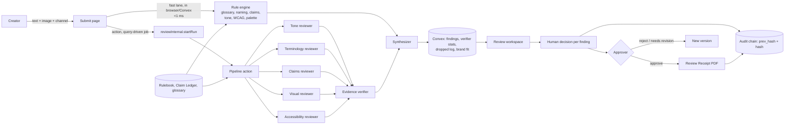

# BrandSentinel

**The brand gate you can audit.** BrandSentinel reviews content against a company's
brand guidelines before it is published, then hands the decision to a person. Every
finding has to show verbatim evidence; every decision is written to a hash-chained
audit trail.

Round 2 prototype, October 2026. Seeded synthetic brand: **Lumora**.

---

## What it does

1. A creator submits a caption, email, ad or document, with an optional image.
2. A **fast lane** runs in code in under a millisecond: prohibited words, product
   naming, casing, claim-ledger matching, tone/jargon, WCAG contrast, alt text.
3. A **deep lane** asks five specialist reviewers (Tone, Terminology, Claims,
   Visual, Accessibility) for findings in one shared schema.
4. An **evidence-or-silence verifier** drops any finding whose span is not
   verbatim in the content, whose rule is not in the rulebook, whose guideline
   excerpt is not from the guideline document, or whose claim id is not in the
   ledger. Low-confidence findings go to **Needs human**.
5. A **synthesizer** de-duplicates, ranks, scores brand fit, and proposes fixes as
   tracked diffs. Nothing is auto-applied.
6. A reviewer accepts, edits or rejects each finding with a reason. An approver
   approves, rejects, or escalates a claims finding to Legal.
7. A **Review Receipt** PDF exports the version hash, findings, human decisions,
   AI services used and the disclosure statement. The **audit chain** can be
   re-verified from the UI.

## Live app

**https://brandsentinel.freebuff.app/**

Built and served in the Freebuff web workspace, on **Vite + React + Convex**. The
build is not on Vercel; see `docs/CHANGES.md` for why the stack changed from the
Round 1 plan.

Repository: **https://github.com/PrachiMaan/brand-sentinel-ai**

The Convex backend for this deployment is
`https://tremendous-rabbit-679.convex.site`.

## Demo login (no signup)

1. Open https://brandsentinel.freebuff.app/ and choose **Try the demo**, or go to
   `https://brandsentinel.freebuff.app/demo`.
2. Pick a seat:
   - **Maya Rao, Creator** — submit and watch the fast lane,
   - **Dev Kapoor, Reviewer** — accept / edit / reject,
   - **Ines Alvarez, Approver** — approve, reject, escalate to Legal, export receipt,
   - **Ravi Shah, Admin** — compile and publish the rulebook.
3. Use the role switcher in the app header at any time. Every switch is audited.
4. On the submit page, press **Load Lumora sample**. It fills a launch caption,
   an off-palette image, hex pair and alt text.

The demo uses anonymous authentication, so no email is collected. The workspace is
shared by all visitors; do not paste confidential material.

## Architecture (what is actually built)



Everything runs inside one Convex deployment: Postgres-backed tables, queries,
mutations, file storage, and node actions for model calls. There is no separate
queue service. A review is a `runs` row with a progress array the UI subscribes to.

## Data model

| Table | Purpose |
| --- | --- |
| `workspaces`, `memberships` | One seeded Lumora workspace; per-user role |
| `brandPacks`, `rules`, `glossary`, `claims` | The published brand pack: typed rules, banned/deprecated terms, claim ledger with expiry |
| `submissions`, `versions` | Content, channel, audience, alt text, image, immutable version hash |
| `runs` | One review run: fast/deep timings, verifier stats, dropped log, model, error |
| `findings` | Shared Finding schema, one row per finding, with source and bucket |
| `decisions` | Accept / edit / reject, reason, edited fix, actor and role |
| `comments` | Threaded notes, optional finding id |
| `auditEvents` | Append-only, `prevHash` + `hash` per row |
| `llmCalls` | Prompt hash, provider, model, latency, tokens, ok/error, redactions |
| `ruleOverrides` | Per-rule accept/edit/reject/escalate counts |
| `compileJobs` | Brand Pack Compiler proposals and publication |

RLS equivalent: every query and mutation resolves the caller's membership and
scopes by `workspaceId`; there are no cross-workspace reads. Convex functions are
the only data path (the client never talks to the database directly).

## The two lanes

**Fast lane** (`src/convex/lib/fastlane.ts`) is plain TypeScript with no network:
banned and deprecated glossary terms (with inflections), full product naming,
sentence case, email subject length, Claim Ledger matching (expired entries,
unsupported percentages/timeframes, medical language), tone/urgency/hype jargon,
WCAG 2.1 contrast from hex pairs or a design swatch, off-palette image colours in
CIELAB, and missing alt text. It returns the same `Finding` schema as the model.

**Deep lane** (`src/convex/ai/pipeline.ts`) runs the five reviewers with
`Promise.all`. Each reviewer receives the delimited content, channel, audience,
image note, the small Claim Ledger and the published rules. Output is validated
with zod; a failed parse triggers one repair attempt, then that reviewer is marked
as an error while the rest of the report continues.

**Verifier** (`src/convex/lib/verifier.ts`): exact span lookup, rule id lookup,
guideline excerpt membership, optional claim id lookup, and a confidence floor.
Dropped counts and reasons are stored and shown; nothing is silently removed.

## Evaluation

The seeded red-team set lives in `eval/dataset.json`: **60 items** across tone,
naming, terminology, unsupported claims, expired claims, visual, accessibility,
clean controls and two prompt-injection probes. Expected rules and failure modes
are recorded per item.

```bash
# one-time: dataset is generated from the Lumora rulebook and seed variation
bun run demo:dataset

# run the real pipeline over the set
VLY_INTEGRATION_KEY=$(bunx convex env get VLY_INTEGRATION_KEY) bun run eval
```

Results are written to `eval/results.json`, `eval/results.md` and
`public/eval/results.json` (the Reliability page reads the last one). There is no
tuning pass: the numbers in the repo are what the run produced.

**Important, read before quoting the numbers.** The run committed in this repo
was made while the model gateway's daily budget was exhausted. All 300 reviewer
calls failed with a quota error, so the committed results measure the
**deterministic rule engine only**, not the full two-lane pipeline. The file says
so in `deepLane` and `notes`. Re-run when model quota is available to measure the
deep lane and verifier suppression.

## Setup

```bash
bun install
bunx convex dev          # interactive in a normal terminal; use --once for codegen
bun run dev              # the Freebuff workspace runs this for you
```

Environment variables (see `.env.example`):

| Variable | Where | Purpose |
| --- | --- | --- |
| `VITE_CONVEX_URL` | client | Convex deployment URL |
| `CONVEX_DEPLOYMENT` | local | Convex project/deployment selector |
| `VLY_INTEGRATION_KEY` | Convex | Model gateway credential (already provisioned) |
| `AI_PROVIDER` | Convex | `vly` (default) or `openai` |
| `AI_MODEL_FAST`, `AI_MODEL_STRONG` | Convex | Model ids; default `gpt-4o-mini` |
| `OPENAI_API_KEY` / `AI_API_KEY`, `AI_BASE_URL` | Convex | Optional OpenAI-compatible provider |

No secrets are committed. The model key lives in the Convex deployment, not in
the repo or the client bundle. Only `.env.example` (empty values) is tracked; all
other env files are gitignored. A scan of the git object store (5 commits, 202
blobs) for API-key formats, private keys, bearer tokens and assignment-style
secrets returned zero hits.

## Known limitations

- **Deep lane was unavailable during the final verification window.** The gateway
  returned `Rate limit exceeded: daily LLM spend budget is exhausted`; the app
  degrades to fast-lane findings and says so in the review banner. The deep-lane
  code path, schemas, verifier and logging are built, but the final end-to-end run
  could not include model output.
- The evaluation set is seeded from the same rulebook the rule engine implements,
  and the engine was developed against it, so its 95% precision / 100% recall is a
  regression result and an upper bound, not a held-out benchmark.
- Multi-page PDF/DOCX submission is **not built** (Tier 3). The submit page accepts
  text and one image. The Brand Pack Compiler does extract text from PDF/DOCX.
- Screenshots could not be captured in this environment: the browser binary needs
  system libraries that the sandbox could not install (no disk space). The
  submission package lists the intended captures instead of inventing them.
- Version control is platform-managed. Commits are made by the workspace and the
  remote is `github.com/PrachiMaan/brand-sentinel-ai`; direct `git push` is
  blocked in the build sandbox, so the mirror is updated by the platform rather
  than by hand. There is no Vercel deployment.
- The receipt PDF is generated client-side with `pdf-lib`; it is a document of
  record, not cryptographically signed. Its version and receipt hashes are also
  recorded in the audit chain.
- Legal escalation marks a finding and the submission; it does not create a
  separate legal workspace.
- Image analysis is limited to dominant colours and alt text. No logo detection,
  text-in-image OCR or layout geometry (that is Round 3).

## AI services and open-source disclosure

Hosted services actually used:

- **Convex** — database, auth, file storage, serverless functions.
- **Freebuff model gateway (Vly integrations)** — chat completions used by the five
  reviewers and the Brand Pack Compiler. Model id is logged per run (`gpt-4o-mini`
  by default, configurable).
- **Freebuff web workspace** — hosting and preview at
  https://brandsentinel.freebuff.app/. No Vercel deployment.
- No Supabase, no Inngest, no Redis, no pgvector.

Open-source libraries: React, Vite, React Router, Tailwind CSS, shadcn/ui, Radix UI,
Lucide, Framer Motion, Convex, `@convex-dev/auth`, zod, `pdf-lib`, `mammoth`,
`pdfjs-dist`, `sonner`.

All model calls are logged to `llmCalls` with prompt hash, provider, model,
latency, token counts, ok/error and redaction count. Content is delimited and
passed as data. Email and phone numbers are redacted before model calls; the
count is logged.

## AI assistance

AI coding agents were used throughout development: scaffolding, Convex schema and
functions, the fast-lane rule engine, the verifier, the review workspace, the
receipt PDF generator, the evaluation harness and this documentation. Product
decisions, rule content, the Lumora seed, the evaluation set and the final review
were directed by the team. Model output in the product is always treated as a
proposal; a human makes the decision, and the UI says so.

## Repository layout

```
src/
  convex/            schema, auth, brand pack, submissions, review pipeline,
                     verifier, audit, compiler, eval helpers
    ai/              provider gateway + five-reviewer pipeline
    lib/             rules engines, Finding schema, Lumora seed, prompts
  pages/             Landing, Demo, Submit, Review, Audit, Rulebook,
                     RuleHealth, Reliability
  components/        app shell, brand primitives
eval/                dataset builder, runner, results
demo-assets/         guideline PDF, captions, sample image
submission/          SUBMISSION.pdf, FORM_ANSWERS.md, DEMO_SCRIPT.md
docs/CHANGES.md      honest change log from the Round 1 plan
```
