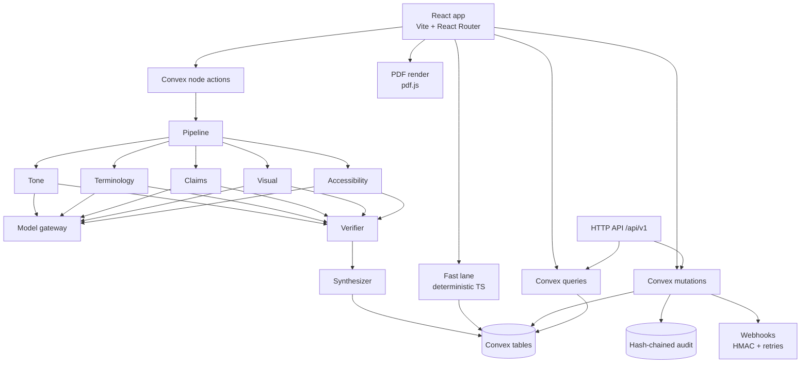

# BrandSentinel

A pre-publication brand gate that reviews content against a company's brand
guidelines, shows evidence for every finding, and hands the decision to a person.
Every decision is written to a hash-chained audit trail.

Round 3 prototype, October 2026. Seeded synthetic brand: **Lumora**.

- Live app: **https://brandsentinel.freebuff.app/**
- Repository: **https://github.com/PrachiMaan/brand-sentinel-ai**
- API base: `https://joyous-herring-358.convex.site/api/v1`

## Try it in 4 minutes (no signup)

1. Open https://brandsentinel.freebuff.app/ and choose **Try the demo**.
2. Pick the **Creator** seat (Maya Rao). The submit page opens with the Lumora
   launch caption loaded and the fast lane already highlighting issues.
3. Press **Submit for review**. The deep lane runs live. All four seeded samples
   also have a saved result from a live run on 29 Oct 2026, used when the gateway
   is unavailable.
4. Accept one finding, edit another, reject a third with a reason.
5. Switch to the **Approver** seat (Ines Alvarez) in the header, approve, and
   export the Review Receipt PDF.
6. Open **Audit** and press **Verify chain**.

The seats:

| Seat | Role | One line |
| --- | --- | --- |
| Maya Rao | Creator | Writes and submits the copy, fixes what comes back |
| Dev Kapoor | Reviewer | Accepts, edits or rejects findings with reasons |
| Ines Alvarez | Approver | Approves or rejects, escalates claims to Legal, exports the receipt |
| Ravi Shah | Admin | Owns the rulebook, compiles guideline packs, manages API keys |

The demo uses anonymous authentication and a single shared workspace. Do not
paste confidential material.

## What it does

1. **Submit** text with a channel, audience, optional image and alt text. PDF and
   DOCX are accepted; PDF pages are reviewed individually, DOCX as text only.
2. **Fast lane** runs in code in under a millisecond: prohibited and deprecated
   terms, product naming and casing, channel limits, claim-ledger matching, tone
   and urgency lexicons, WCAG contrast, off-palette image colours, missing alt
   text. Highlights appear as you type.
3. **Deep lane** asks five specialists (Tone, Terminology, Claims, Visual,
   Accessibility) in parallel, in one shared schema. Content is delimited as data,
   PII is redacted before the call.
4. **Verifier** drops any finding whose quote is not verbatim in the content,
   whose rule is not published, whose guideline excerpt is not from the rulebook,
   whose claim id is unknown, or that contradicts an approved Claim Ledger entry.
   Low-confidence findings go to **Needs human**.
5. **Synthesizer** de-duplicates, ranks, scores brand fit and proposes fixes as
   tracked diffs with an intent score. Nothing is auto-applied.
6. **Human review**: accept, edit or reject each finding with a reason; comment;
   request revision (new version); approve, reject, or escalate to Legal.
7. **Receipt and audit**: a Review Receipt PDF with the version hash, findings,
   decisions, models used and the AI disclosure. The audit chain can be re-verified
   from the UI.

Beyond the core loop:

- **Visual Consistency Engine v2** — logo presence, margin, clear space, palette
  distance in CIELAB, type family and size, ink density, with page overlays.
- **Brand Drift and Rule Health** — override rates with confidence intervals,
  per-channel drift, suggested rewordings citing decisions, over a labelled
  synthetic 90-day history.
- **Review API and webhooks** — scoped keys, idempotency, OpenAPI, signed HMAC
  deliveries with retries and a dead-letter view, plus a Google Docs sidebar.

## Architecture



One Convex deployment holds the database, auth, file storage and functions. There
is no separate queue, cache, vector store or search service. A review is a `runs`
row with a progress array; the UI subscribes to it.

## Stack

| Layer | Choice |
| --- | --- |
| Client | Vite, React 19, React Router 7, TypeScript, Tailwind CSS 4, shadcn/ui, Radix, Framer Motion |
| Backend | Convex (queries, mutations, node actions, file storage), Convex Auth (anonymous demo sessions) |
| Validation | zod for all model output and HTTP input |
| Documents | pdfjs-dist (render and text), mammoth (DOCX), pdf-lib (receipt) |
| Tests and evals | Bun test, Bun scripts, generated PDF/PNG fixtures |
| Hosting | Freebuff web workspace (not Vercel) |

## Two lanes and the verifier

**Fast lane** (`src/convex/lib/fastlane.ts`) is plain TypeScript. It runs in the
browser on every keystroke and again on the server at submit. Median 0.153 ms over
the 60-item eval set.

**Deep lane** (`src/convex/ai/pipeline.ts`) calls five reviewers with
`Promise.all`, each with the published rules for its category, the six-entry Claim
Ledger, voice descriptors, channel, audience and an image note. Output is
validated with zod; a parse failure gets one repair attempt, then that reviewer is
marked failed and the rest of the report continues.

**Verifier** (`src/convex/lib/verifier.ts`): verbatim span, known rule id,
guideline excerpt membership, known claim id, visual page/box/measurement, and the
approved-copy rule. Drops and reasons are stored and shown; nothing is silently
removed. On the four live sample runs it suppressed 14 of 30 model findings.

**Audit**: every state change appends `seq`, `prevHash`, `hash` (SHA-256 over
canonical JSON including the previous hash). **Verify chain** recomputes the whole
chain and reports the first break.

## Setup

Prerequisites: Bun 1.4+, Node 20+ (for a few scripts), and a Convex account for a
new deployment. The prototype's deployment is already provisioned.

```bash
bun install
bunx convex dev            # links the project, pushes schema, generates types
bun run dev                # Vite dev server (the Freebuff workspace runs this)
```

In a non-interactive shell, use `bunx convex dev --once` to codegen and push, then
typecheck:

```bash
bunx convex dev --once && bunx tsc -b --noEmit
```

Seeding: there is no separate seed command. The first demo login creates the
Lumora workspace, brand pack, rules, claims, glossary, palette and voice, and is
idempotent. Sample content is loaded from the submit page with **Load Lumora
sample**, **Launch email**, **Clean control**, **Injection probe**, or the two
sample decks.

Regenerate demo assets or the eval dataset:

```bash
bun run demo:assets
bun run demo:dataset
```

### Environment variables

Tracked: `.env.example` only, with placeholders. No secrets are committed.

| Variable | Where | Required | Purpose |
| --- | --- | --- | --- |
| `VITE_CONVEX_URL` | client env | yes | Convex deployment URL |
| `CONVEX_DEPLOYMENT` | local CLI | yes | Deployment selector for `convex dev` |
| `CONVEX_SITE_URL` | local / deployment | for auth and API | HTTP actions base |
| `VLY_INTEGRATION_KEY` | Convex deployment | no | Built-in model gateway credential |
| `LLM_BASE_URL`, `LLM_API_KEY` | Convex deployment | no | Any OpenAI-compatible endpoint |
| `LLM_MODEL`, `LLM_MODEL_STRONG` | Convex deployment | no | Model ids; default `gpt-4o-mini` |
| `APP_BASE_URL` | Convex deployment | no | Link base in webhook payloads |

Set the model variables in the Convex dashboard or with
`bunx convex env set NAME value`. The app never reads a secret in the browser.

## Running without a model key

This is the normal state of the prototype.

- The fast lane, visual engine, drift analytics, API and webhooks never need a
  model.
- A **seeded sample** replays a saved deep-lane result for the same content hash
  and rulebook version. It is re-verified on replay and labelled
  "Saved from a live run on <date>, <model>". Four saved runs exist (29 Oct 2026).
- **Custom content** tries the gateway; on failure it keeps fast-lane findings,
  names the cause (budget, rate limit, timeout, invalid output, gateway down,
  unconfigured) and offers **Retry deep review**. Three consecutive failures open
  a 90-second circuit breaker so a dead gateway fails fast.
- Nothing in the UI claims the model always runs.

## Tests and evaluation

```bash
bun test                 # 80 unit tests, 10 files
bun run typecheck        # tsc -b --noEmit
bun run lint             # eslint
bun run eval             # red-team set, deterministic lane, writes eval/results.json
bun run eval:visual      # visual engine fixtures, writes eval/visual-results.json
bun run eval:analytics   # recompute consistency, writes eval/analytics-results.json
```

Type-checking and tests/webhook-delivery.test.ts need generated Convex types. Run bunx convex dev --once once (needs a Convex login) before bun test and bunx tsc -b --noEmit.

Current numbers and how to read them: **`docs/EVALUATION.md`**. Summary:

| Eval | Result |
| --- | --- |
| Red-team, 60 items | 95.2% precision, 100% recall — deterministic rule engine only |
| Visual, 2 × 10-page decks | 7/7 found, IoU ≥ 0.70 on all seven (mean 0.918, density 0.862), 0 findings on the clean deck, 54–73 ms/page |
| Analytics | 0 mismatches vs independent recomputation, idempotent, 3 evidenced suggestions |
| Deep lane | 4 saved live runs: 30 model findings, 16 kept, 14 suppressed by the verifier |
| Review API, live | 12/12 checks: submit, replay, 409, 403, findings, decisions, approve, receipt manifest, 429 |
| Webhooks, live | External echo delivered 200; failure endpoint recorded 500 and scheduled a retry |

The red-team run had no model credential, so it does not measure the deep lane.
No deep-lane precision or recall is claimed. Fixtures are synthetic and
self-authored, so these numbers are upper bounds.

## Review API

Base: `https://joyous-herring-358.convex.site/api/v1`. OpenAPI:
`GET /api/v1/openapi.json`.

```bash
curl -sS -X POST "$BASE/submissions" \
  -H "Authorization: Bearer $KEY" \
  -H "Idempotency-Key: launch-001" \
  -H "content-type: application/json" \
  -d '{"text":"Glow Serum is a MIRACLE.","channel":"instagram"}'
```

Create keys in the app as an admin under **API & Webhooks**; the key is shown
once and stored hashed. Endpoints, scopes, error codes, idempotency and the
webhook signing algorithm are documented in **`docs/API.md`**.

The API was exercised live end to end on 29 October 2026 with keys created through
the app: submit, same-key replay, 409 on a conflicting body, 403 for a creator key
approving, findings, decisions, approval and 429. `scripts/api-demo.ts` reproduces
the run and asserts every status. The external webhook echo returned 200; signature
verification is proven against a local receiver with the production handler.

## Google Docs sidebar

`integrations/google-docs/` contains the Apps Script files and an install guide.
It has never been installed in Google Workspace in this environment; see
`docs/KNOWN_LIMITATIONS.md`.

## Repository layout

```
src/
  convex/            schema, auth, brand pack, submissions, review, verifier,
                     audit, compiler, API, webhooks, analytics, visual engine
    ai/              provider gateway and five-reviewer pipeline
    lib/             rules engines, Finding schema, Lumora seed, prompts, history
  pages/             Landing, Demo, Submit, Review, Audit, Rulebook, RuleHealth,
                     Reliability, ApiAccess, Auth
  components/        app shell and brand primitives
eval/                dataset, runners, result files, fixtures
tests/               unit tests
scripts/             API demo, demo assets, visual fixtures, submission build
integrations/        Google Docs sidebar
public/demo-assets/  sample guideline PDF, image, decks, captions
docs/                audit, architecture, features, improvements, API, evaluation,
                     test results, limitations, roadmap, changelog, handoff
```

## Troubleshooting

| Symptom | Cause and fix |
| --- | --- |
| Blank preview or "Did you forget to run convex dev?" | Types or functions are stale. Run `bunx convex dev --once`, then `bunx tsc -b --noEmit` |
| Review says "No model credentials are configured" | The deployment has no gateway key. Saved runs still replay; set `LLM_API_KEY`/`LLM_BASE_URL` or `VLY_INTEGRATION_KEY` to run live |
| Review says the model budget is exhausted | Deployment-level gateway budget. Wait for reset, or use saved samples; the fast lane still works |
| "Save model results for samples" saves nothing | Budget exhausted or no sample submissions exist. Load and submit a sample first |
| PDF page never renders | pdf.js needs a secure context and a PDF under the size cap. DOCX is text-only by design |
| `/api/v1` returns 401 | Missing or revoked key. Create one under **API & Webhooks**; keys are shown once |
| Audit chain fails | A row was modified or removed. The verifier names the sequence number and rule that broke |

## Documentation

- `docs/ARCHITECTURE.md` — diagrams, data model, security, degraded mode
- `docs/FEATURES.md` — what exists, with status
- `docs/IMPROVEMENTS_R3.md` — the three Round 3 improvements, measured
- `docs/EVALUATION.md` — all numbers and how to read them
- `docs/TEST_RESULTS.md` — what was run, what was not
- `docs/AUDIT.md` — requirement-by-requirement status
- `docs/API.md` — endpoints, errors, webhooks
- `docs/KNOWN_LIMITATIONS.md` — honest gaps
- `docs/ROADMAP.md`, `docs/CHANGELOG.md`, `docs/HANDOFF.md`, `docs/CHANGES.md`

## AI services and open-source disclosure

Hosted services used:

- **Convex** — database, auth, file storage, functions.
- **Model gateway** — hosted chat completions through the Freebuff/Vly gateway,
  `gpt-4o-mini` by default, used by the five reviewers and the Brand Pack
  Compiler. Every call is logged with prompt hash, provider, model, latency,
  tokens, outcome and redaction count.
- **Freebuff web workspace** — hosting at the live URL.

No Supabase, Vercel, Inngest, Redis, pgvector or external analytics.

Open-source: React, React DOM, Vite, React Router, Tailwind CSS, shadcn/ui, Radix
UI, Lucide, Framer Motion, Convex client, `@convex-dev/auth`, zod, pdf-lib,
mammoth, pdfjs-dist, sonner, date-fns, recharts, Hono.

## AI assistance

AI coding agents were used during development for scaffolding, the Convex schema
and functions, the rule engine, the verifier, the review workspace, the visual
engine, analytics, the API and webhook code, the evaluation harness and the
documentation. The product decisions, the Lumora brand pack, the rule content, the
red-team set and the final review were directed by the team. Model output inside
the product is always a proposal: a person decides, and the interface says so.

## Known limitations

Read `docs/KNOWN_LIMITATIONS.md` before judging a claim. The short version: no
browser was available in the build sandbox, so UI journeys and screenshots are
unverified; the external webhook receiver does not inspect signatures (that is
proven locally); live dead-lettering would take hours of backoff (proven through
the real retry mutation instead); the Google Docs sidebar was never installed; and
the deep lane is measured on four saved samples plus one live API run rather than
a benchmark.
