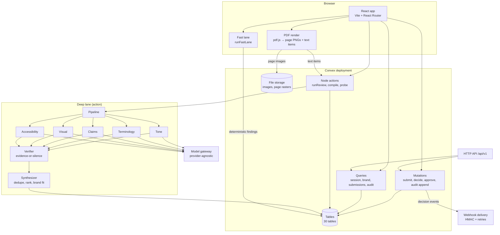

# Architecture

BrandSentinel is a Vite + React single-page app over a Convex deployment. Convex
provides the database, authentication, file storage and serverless queries,
mutations and Node actions. There is no separate queue, cache or vector store.

## Request paths

The client subscribes to Convex queries, so a review updates as the run row and
findings rows change. There is no polling loop in the web app for the review
itself; the Google Docs sidebar polls the HTTP API because it has no client.

## Two lanes

**Fast lane** — pure TypeScript, no network, runs in the browser on every
keystroke and again on the server at submit time. It checks prohibited and
deprecated glossary terms, product naming and casing, channel limits, claim
ledger matches (expired, expiring, unsupported numbers and timeframes, medical
language), tone and urgency lexicons, WCAG 2.1 contrast, off-palette image
colours in CIELAB and missing alt text. Output uses the same `Finding` schema as
the model. Median evaluation time: 0.153 ms.

**Deep lane** — `src/convex/ai/pipeline.ts`. Five reviewers run with
`Promise.all`; each receives the published rules for its category, the small
Claim Ledger, voice descriptors, channel, audience, an image note and the
submitted content inside `<submitted_content>` tags. Content is redacted for
emails and phone numbers before the call and restored afterwards. Output is
validated with zod; a parse failure triggers one repair prompt, then that reviewer
is marked failed while the others continue.

## Evidence-or-silence verifier

`src/convex/lib/verifier.ts` admits a model finding only when all of these hold:

1. The quoted `span_text` appears verbatim in the submitted content.
2. The `rule_id` exists in the currently published rulebook.
3. The `guideline_excerpt` is a quote from that rule or the guideline document.
4. A claim id, when cited, exists in the Claim Ledger.
5. Visual findings, when they carry a page or box, carry both plus a measured
   value, with the page in range and the box inside the page.
6. The quote is not approved copy from a non-expired Claim Ledger entry. The
   ledger is authoritative; a model may not contradict it.

Findings with confidence below 0.6 are kept but placed in the **Needs human**
bucket. Every drop is counted by reason and stored with the run. Saved results
are re-checked through the same rules on replay, against the current rulebook.

## Visual pipeline

1. The browser renders each PDF page with pdf.js, captures a PNG and the text
   items with their positions (`src/lib/pdf.ts`).
2. Page images go to Convex file storage, page metadata to `visualAssets`.
3. `src/convex/visual.ts` analyses pages deterministically: palette distance in
   CIELAB, ink density, body-type size distribution, serif share, logo template
   correlation, logo margin and clear space.
4. Every finding carries `page`, a normalised `bbox`, a `measured` value and a
   published rule id, or it is dropped.

DOCX is text-only and says so in the UI; no visual claim is made for it.

## Brand Drift and Rule Health

`src/convex/lib/history.ts` builds a deterministic synthetic 90-day history from
a fixed seed. `src/convex/analytics.ts` aggregates decisions and findings into
`ruleHealth` (override rate with a Wilson interval, sample gate at 20 decisions)
and `ruleSuggestions` (rules with a high override or drift signal, each citing
decision records). Aggregates are recomputed on demand by an admin and daily at
02:30 UTC. `eval/analytics-check.ts` recomputes the same numbers independently
from raw rows and compares them.

## API and webhooks

`src/convex/http.ts` routes `/api/v1/*` to a single Hono handler in
`src/convex/httpApi.ts`. The OpenAPI document lives in the same file as the
handler so the two cannot drift apart by accident. API keys are scoped creator,
reviewer or approver, stored as SHA-256 hashes, and only the hash is compared on
each request. Mutations reached through the API reuse the same submission and
decision logic as the web app, including the state machine.

Webhook deliveries are signed with HMAC-SHA256 over `${timestamp}.${body}` and
retried on a fixed backoff (1 m, 5 m, 30 m, 2 h, 6 h) before being marked dead.
Endpoints are vetted against private, loopback and link-local addresses.

## Data model (30 tables)

| Group | Tables |
| --- | --- |
| Identity | `users`, `workspaces`, `memberships`, `demoProgress` |
| Brand pack | `brandPacks`, `rules`, `glossary`, `claims`, `ruleDrafts`, `compileJobs` |
| Content | `submissions`, `versions` |
| Review | `runs`, `findings`, `decisions`, `comments`, `visualAssets`, `visualRuns`, `cachedRuns` |
| Audit and model | `auditEvents`, `llmCalls`, `modelState` |
| Analytics | `ruleOverrides`, `ruleHealth`, `ruleSuggestions` |
| Integration | `apiKeys`, `webhookEndpoints`, `webhookDeliveries`, `idempotencyKeys` |
| Legal | `legalCases` |

Each finding row stores the shared schema: `id`, `reviewer`, `severity`,
`confidence`, `spanText`, `spanStart`, `spanEnd`, `ruleId`, `guidelineExcerpt`,
`whyItMatters`, `suggestedFix`, `status`, plus `source`, `bucket`, `evidenceType`,
optional claim fields, intent score and fix risk, and for visual findings `page`,
`bbox`, `measured` and `threshold`.

## Audit chain

Every state change appends a row to `auditEvents` with `seq`, `prevHash` and
`hash`. The hash is SHA-256 over a canonical JSON serialisation of the row with
the previous hash included. `audit:verifyChain` recomputes the chain in order and
reports the first broken sequence, link or hash. Deletion or editing of any row
breaks verification at that entry.

## Security model

- **Workspace isolation.** Every query, mutation, action and HTTP route resolves
  the caller's membership and filters by `workspaceId`. Convex functions are the
  only data path; the client never holds database credentials.
- **Role enforcement on the server.** Creator, reviewer, approver and admin are
  checked in the mutation that performs the action, not only in the UI. API keys
  carry the same scopes.
- **Content is data.** Submitted text is delimited, the system prompt states that
  it is data, and the required output is JSON. Findings are re-verified against
  the content, so an injected instruction cannot fabricate evidence.
- **PII redaction.** Emails and phone numbers are replaced before model calls and
  restored in the returned text. The redaction count is logged per call.
- **Secrets.** The model credential lives in the Convex deployment environment.
  API keys are stored hashed and shown once. Webhook secrets are shown once. No
  secret is in the client bundle or the repository.

## Degraded mode

If the model is unavailable, the run still completes:

1. A seeded sample replays a saved result for the same content hash and rulebook
   version, re-verified on the way in, labelled "Saved from a live run on …".
2. Otherwise the run keeps fast-lane findings, records the cause
   (`budget_exhausted`, `rate_limited`, `timeout`, `invalid_output`,
   `gateway_down`, `unconfigured`) and shows a banner with a retry action.
3. Three consecutive failures open a per-process circuit breaker for 90 seconds
   so a dead gateway fails fast instead of timing out five times.

Visual review, drift analytics, the API and webhooks do not depend on the model.
